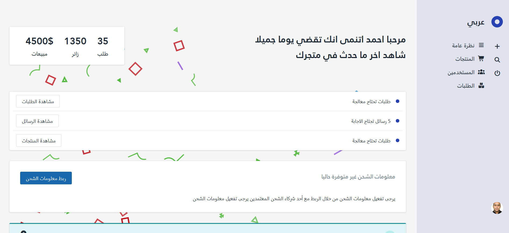

# 📊 E-Commerce Admin Dashboard | لوحة تحكم المتجر الإلكتروني

> **A modern, responsive multi-page frontend dashboard built as a practical training project to master ITCSS architecture, Vite MPA bundling, Handlebars templating, and Vanilla JavaScript.**  
> **لوحة تحكم إدارية متعددة الصفحات ومتجاوبة، نُفذت كمشروع تدريبي عملي لإتقان معمارية ITCSS، وبناء تطبيقات MPA عبر Vite، وقوالب Handlebars، وتفاعلية Vanilla JavaScript.**

<p align="center">
  <a href="#-english-version">English</a> • <a href="#-النسخة-العربية">العربية</a>
</p>

---

<div id="-english-version"></div>

# 🇬🇧 English Version

## E-Commerce Admin Dashboard
A modern, responsive frontend application designed to deliver a smooth and user-friendly digital experience for online store management.

---

### 📌 Project Overview
**E-Commerce Admin Dashboard** is a multi-page frontend application developed as a practical dashboard interface for managing an online store.

The project was built with a strong focus on responsive design, reusable UI components, clean CSS architecture, and intuitive navigation across different screen sizes. It was developed as a hands-on training project to master modern frontend workflows without relying on heavy CSS frameworks or complex full-stack libraries.

The application includes multiple operational pages and a dedicated UI component showcase library.

---

### 🎯 Project Goals
The main goals of this project were to:
* **Build a responsive and modern interface** tailored for Arabic Right-to-Left (RTL) workflows.
* **Master CSS architecture** using the ITCSS (Inverted Triangle CSS) methodology and BEM naming conventions from scratch.
* **Implement a Multi-Page Application (MPA)** using Vite and Handlebars to eliminate repetitive HTML code.
* **Organize the project using a scalable structure** separating styling layers, templates, and scripts.
* **Practice Vanilla JavaScript DOM interactions** including chart rendering, custom file uploads, and UI transitions.

---

### 🚀 Live Demo
[View Live Demo](https://mohammed-mfsa99.github.io/control-panel/)

---

### 📸 Screenshots

| Dashboard Overview | Products Management |
| :---: | :---: |
|  | *Products listing table with bulk selection* |

| Add Product Form | Orders & Users |
| :---: | :---: |
| *Product form with live image preview* | *Orders tracking and customer directory* |

---

### ✨ Features

#### 🔹 General & Architecture
* **Multi-Page Application (MPA):** Configured with Vite and Rollup for clean multi-page builds.
* **Reusable Layouts & Partials:** Handlebars templates for sidebars, tables, and headers to keep markup DRY.
* **Component Showcase Library:** 13 standalone component pages inside `components/` for isolated UI testing.
* **Scalable ITCSS Architecture:** Strict separation of config, base, components, pages, and utility layers.

#### 🔹 Dashboard & Analytics
* **Store Metrics:** Quick counters for pending orders, daily visitors, and total revenue.
* **Interactive Sales Chart:** Line chart powered by Chart.js configured for RTL readability.
* **Actionable Alerts & Banners:** Notification banner with smooth animated collapse upon dismissal.
* **Status Tabs:** Tabbed navigation to review urgent orders, low-stock items, and new customers.

#### 🔹 Inventory & Operations
* **Product Listing:** Data table displaying product photos, base prices, local prices, and stock counts.
* **Add Product Workflow:** Form featuring real-time image preview via `FileReader` API, multi-currency pricing, and dimension fields.
* **Order Management:** Status badges (Shipped, Processing), quick actions, and shipping destination tracking.
* **User Directory:** Customer listing with avatars, order history, and balances.

#### 🔹 User Experience & Styling
* **RTL-First Design:** Native Right-to-Left layout with custom Arabic typography (Janna font family).
* **Interactive Controls:** Checkbox selection for tables, buttons with hover/active states, and accessible form textfields.
* **Responsive Layout:** Adapts seamlessly between desktop workstations, laptops, and mobile screens.

---

### 🛠️ Tech Stack

#### Frontend
* **HTML5:** Semantic markup structured with Handlebars partials.
* **SCSS / Sass:** Modular styling based on ITCSS architecture and BEM naming conventions.
* **Vanilla JavaScript (ES Modules):** Lightweight DOM scripting without third-party frameworks.
* **Chart.js:** Client-side data visualization for monthly sales statistics.
* **Normalize.css:** Cross-browser default style normalization.
* **Font Awesome 6:** Iconography across navigation and action buttons.

#### Tools & Build
* **Vite:** Modern build tool, local dev server, and Rollup multi-page packager.
* **vite-plugin-handlebars:** HTML templating and partials compilation.
* **PostCSS & PostCSS Preset Env:** CSS vendor prefixing and modern syntax compatibility.
* **npm:** Dependency management.
* **Git & GitHub:** Version control and source code hosting.

---

### 📂 Project Structure

```text
control-panel-vite/
│
├── components/                  # Isolated UI component showcase (Styleguide)
│   ├── actions.html             # Quick action items preview
│   ├── banner.html              # Dismissible alert banner
│   ├── button.html              # Button variations (primary, ghost, destructive)
│   ├── card.html                # Informational cards
│   ├── chart.html               # Chart canvas container
│   ├── table.html               # Data table styling
│   ├── textfield.html           # Input fields and labels
│   ├── upload.html              # Image upload dropzone
│   └── ...                      # Other individual UI components
│
├── public/                      # Static assets and SCSS source files
│   ├── fonts/                   # Local Arabic typography (Janna WOFF)
│   ├── images/                  # Demo products, avatars, and icons
│   └── styles/                  # ITCSS-structured SCSS architecture
│       ├── base/                # Typography, global reset, links, font-face
│       ├── components/          # Reusable component stylesheets (BEM)
│       ├── config/              # SASS variables, colors, layout grid
│       ├── hacks/               # Isolated page-specific adjustments
│       ├── pages/               # Specific layout styles (index, single-page)
│       ├── utilites/            # Helper mixins and spacing classes
│       └── style.scss           # Main stylesheet importing all layers
│
├── src/
│   ├── partials/                # Reusable Handlebars template partials
│   │   ├── layout.hbs           # Base HTML document wrapper
│   │   ├── sidebar.hbs          # Main navigation sidebar
│   │   ├── table-header.hbs     # Table title, counter, and actions
│   │   ├── table-navigation.hbs # Pagination controls
│   │   └── select-all.hbs       # Master table checkbox
│   ├── scripts/                 # Page-specific JavaScript modules
│   │   ├── home.js              # Chart.js initialization and banner events
│   │   └── upload.js            # FileReader image preview and removal logic
│   └── main.js                  # Global JavaScript entry point
│
├── index.html                   # Dashboard overview page
├── products.html                # Products catalog page
├── add-product.html             # Product creation page
├── users.html                   # Users list page
├── add-user.html                # User registration page
├── orders.html                  # Orders tracking page
├── vite.config.js               # Vite Rollup multi-page & Handlebars config
├── postcss.config.js            # PostCSS Autoprefixer config
├── package.json                 # Project dependencies and npm scripts
└── README.md                    # Project documentation
```

---

### ⚙️ Requirements
Before running the project locally, make sure you have:
* **Node.js** (v18.0.0 or higher recommended)
* **npm** (comes with Node.js)
* **Git** installed on your system

---

### 💻 Installation

1. Clone the repository:
   ```bash
   git clone https://github.com/username/control-panel-vite.git
   ```
2. Move into the project directory:
   ```bash
   cd control-panel-vite
   ```
3. Install dependencies:
   ```bash
   npm install
   ```

---

### ▶️ Running the Project

* Start the development server with Hot Module Replacement:
  ```bash
  npm run dev
  ```
* Create an optimized production build:
  ```bash
  npm run build
  ```
* Preview the generated production build locally:
  ```bash
  npm run preview
  ```

---

### 📱 Responsive Design
The application has been designed and tested for:
* **Desktop Monitors:** Full multi-column layout with fixed sidebar.
* **Laptops & Tablets:** Proportional grids and scrollable tables.
* **Mobile Devices:** Stacked layouts and touch-friendly controls.
* **RTL Support:** Full Right-to-Left orientation designed natively for Arabic content.

---

### 🧩 Main Pages
The project contains the following pages:
1. **لوحة التحكم الرئيسية (Dashboard):** Summary counters, sales statistics chart, dismissible banners, and task tabs (`index.html`).
2. **المنتجات (Products):** Product listing table with bulk selection and action buttons (`products.html`).
3. **إضافة منتج (Add Product):** Comprehensive form with live image preview and dimensional metrics (`add-product.html`).
4. **المستخدمين (Users):** User directory displaying profile avatars, sales metrics, and emails (`users.html`).
5. **إضافة مستخدم (Add User):** New account creation form with password confirmation and avatar upload (`add-user.html`).
6. **الطلبات (Orders):** Order fulfillment tracking with direct action buttons (`orders.html`).
7. **معرض المكونات (Component Showcase):** 13 isolated component tests located inside `components/`.

---

### 📚 What I Learned
During the development of this training project, I practiced:
* Structuring a production-grade multi-page application with **Vite** and Rollup.
* Applying **ITCSS (Inverted Triangle CSS)** to maintain low CSS specificity and prevent style leakage.
* Adhering to the **BEM methodology** with a component prefix convention (`.c-`).
* Using **Handlebars partials** to avoid repetitive HTML code across pages.
* Handling real-time client-side image uploads using the native JavaScript `FileReader` API.
* Configuring and customizing **Chart.js** for custom RTL layouts and styling.
* Managing modern CSS tools including PostCSS Preset Env and Sass modules (`@use`).

---

### 🧠 Challenges
Some of the main challenges encountered and solved:
* **Low-Specificity Styling:** Writing pure SCSS for a full admin dashboard without using utility frameworks required discipline in structuring ITCSS layers.
* **Chart.js RTL Adaptation:** Adjusting axes positioning and tooltips in Chart.js to fit an Arabic right-to-left layout.
* **Component Modularity:** Decoupling template partials (`.hbs`) so they remain flexible across different page contexts.
* **Interactive Image Upload:** Building an accessible file upload dropzone with instant preview and safe image reset in pure Vanilla JS.

---

### 🔮 Future Improvements
Planned enhancements for future iterations:
* [ ] Connect the frontend to a RESTful API or mock JSON server.
* [ ] Add client-side form validation with visual error feedback.
* [ ] Implement client-side table sorting, filtering, and real pagination.
* [ ] Persist mock data into browser `localStorage`.
* [ ] Add a light/dark theme toggle.
* [ ] Enhance keyboard accessibility and ARIA labels.

---

### 👨‍💻 Author
**Mohammed Faez**  
*Frontend Web Developer*  
* GitHub: [@mohammed-MFSA99](https://github.com/mohammed-MFSA99)  
* LinkedIn: [Mohammed Faez](https://linkedin.com/)  
* Portfolio: [mohammed-mfsa99.github.io](https://mohammed-mfsa99.github.io/)

---

### 📄 License
This project is open-source and licensed under the [MIT License](LICENSE).

---
---

<div id="-النسخة-العربية"></div>

# 🇸🇦 النسخة العربية

## لوحة تحكم إدارية لمتجر إلكتروني
واجهة أمامية حديثة ومتجاوبة، صُممت لتوفير تجربة استخدام سلسة ومنظمة لإدارة المتاجر الإلكترونية باللغة العربية.

---

### 📌 نظرة عامة على المشروع
**لوحة تحكم المتجر الإلكتروني (E-Commerce Admin Dashboard)** هو تطبيق واجهة أمامية متعدد الصفحات (Multi-Page Application) تم تطويره كنموذج عملي للوحة تحكم إدارية.

تم بناء المشروع بتركيز أساسي على التصميم المتجاوب، وإعادة استخدام المكونات، ومعمارية CSS نظيفة وقابلة للتوسع، مع دعم أصيل للغة العربية (RTL). يُعد المشروع **تطبيقاً تدريبياً عملياً** يهدف إلى ترسيخ أفضل ممارسات تطوير الواجهات الكلاسيكية الحديثة دون الاعتماد على أطر عمل جاهزة مفرطة التعقيد.

يتضمن المشروع صفحات تشغيلية متعددة بالإضافة إلى مكتبة مستقلة لعرض المكونات واختبارها.

---

### 🎯 أهداف المشروع
تمثلت الأهداف الرئيسية من بناء هذا المشروع في:
* **بناء واجهة حديثة ومتجاوبة** مصممة خصيصاً لتناسب اتجاه اللغة العربية (RTL).
* **إتقان معمارية الـ CSS** من خلال تطبيق منهجية ITCSS ونمط التسمية BEM بشكل يدوي منظم.
* **تطبيق مفهوم التطبيقات متعددة الصفحات (MPA)** باستخدام أداة Vite وقوالب Handlebars لاختصار تكرار كود الـ HTML.
* **تنظيم المشروع بهيكلية احترافية** تفصل طبقات التنسيق والقوالب والسكربتات.
* **ممارسة تفاعلية جافاسكريبت الخام (Vanilla JS)** مثل الرسوم البيانية، ومعاينة رفع الملفات، والتحكم بالـ DOM.

---

### 🚀 المعاينة المباشرة (Live Demo)
[مشاهدة المعاينة المباشرة](https://mohammed-mfsa99.github.io/control-panel/)

---

### 📸 لقطات شاشة (Screenshots)

| نظرة عامة على لوحة التحكم | إدارة المنتجات |
| :---: | :---: |
|  | *جدول استعراض المنتجات مع إمكانية التحديد الجماعي* |

| نموذج إضافة منتج | الطلبات والمستخدمين |
| :---: | :---: |
| *نموذج الإضافة مع معاينة فورية للصورة* | *متابعة حالات الطلبات ودليل العملاء* |

---

### ✨ المميزات المنفذة

#### 🔹 الهيكلية والمعمارية العامة
* **تطبيق متعدد الصفحات (MPA):** تكامل مع Vite و Rollup لتجميع الصفحات بشكل منفصل وبأداء عالٍ.
* **قوالب ومكونات قابلة لإعادة الاستخدام:** استغلال Handlebars لإنشاء قوالب مشتركة (القائمة الجانبية، الترويسات، الجداول) تطبيقاً لمبدأ عدم تكرار الكود (DRY).
* **مكتبة استعراض المكونات:** وجود 13 صفحة مخصصة في مجلد `components/` لاختبار كل مكون بصري بشكل منعزل.
* **معمارية ITCSS للتنسيق:** تقسيم منضبط لملفات SCSS لمنع مشاكل تعارض الخصوصية (Specificity).

#### 🔹 لوحة الإحصائيات والمتابعة
* **بطاقات ملخص العمليات:** عرض سريع لعدد الطلبات المعلقة، الزوار، وإجمالي المبيعات.
* **رسم بياني تفاعلي للمبيعات:** رسم خطي مبني عبر Chart.js مع تعديل محاذاة المحاور للواجهة العربية.
* **إشعارات وتنبيهات تفاعلية:** بانر تنبيه قابل للإغلاق مع حركة انكماش سلسة (Collapse transition).
* **تبويبات سريعة للمهام:** التنقل بين الطلبات التي تتطلب مراجعة، المنتجات المنتهية، والعملاء الجدد.

#### 🔹 إدارة المتجر والعمليات
* **قائمة المنتجات:** جدول بيانات يعرض صور المنتجات، الأسعار الأساسية والمحلية، والكميات المتوفرة.
* **نموذج إضافة منتج:** حقول لإدخال تفاصيل المنتج، والأسعار بعملات متعددة، والأبعاد، مع رفع ومعاينة فورية للصورة عبر `FileReader`.
* **إدارة الطلبات:** تصنيف حالات الشحن (تم الشحن، قيد المعالجة)، وإجراءات تواصل وحذف فورية.
* **دليل المستخدمين:** قائمة بالعملاء مع صورهم الشخصية، ومعدلات الشراء، وأرصدتهم.

#### 🔹 تجربة المستخدم والتصميم
* **دعم أصيل للغة العربية (RTL):** محاذاة سليمة تماماً مع استخدام خطوط عربية محلية مدمجة (Janna Font).
* **عناصر تحكم متكاملة:** مربعات اختيار لتحديد الكل في الجداول، أزرار تفاعلية بحالات مختلفة، وحقول إدخال واضحة.
* **تصميم متجاوب:** تجربة متناسقة تعمل عبر الشاشات الكبيرة والمحمولة والأجهزة اللوحية والهواتف.

---

### 🛠️ التقنيات المستخدمة (Tech Stack)

#### واجهة المستخدم (Frontend)
* **HTML5:** بناء دلالي مدعوم بقوالب Handlebars عبر إضافة `vite-plugin-handlebars`.
* **SCSS / Sass:** كتابة تنسيقات متقدمة معمارياً وفق ITCSS واستخدام بادئات BEM (`c-`).
* **Vanilla JavaScript:** كتابة شفرة نظيفة تعتمد على معايير ES Modules دون الحاجة لمكتبات ثقيلة.
* **Chart.js:** لتمثيل بيانات المبيعات برسم بياني تفاعلي وخفيف.
* **Normalize.css:** لتوحيد إعدادات التنسيق الافتراضية عبر المتصفحات.
* **Font Awesome 6:** أيقونات التنقل والأزرار والعمليات.

#### الأدوات وبيئة التطوير (Tools)
* **Vite:** بيئة التطوير السريعة وتجميع ملفات الإنتاج متعددة الصفحات.
* **PostCSS & PostCSS Preset Env:** لدعم الخصائص الحديثة وإضافة البادئات تلقائياً (Autoprefixer).
* **npm:** إدارة حزم ومكتبات المشروع.
* **Git & GitHub:** إدارة النسخ ومستودع الكود البرمجي.

---

### 📂 هيكل المشروع (Project Structure)

```text
control-panel-vite/
│
├── components/                  # مكتبة استعراض واختبار المكونات المستقلة
│   ├── actions.html             # استعراض مكون الإجراءات السريعة
│   ├── banner.html              # استعراض البانر التنبيهي
│   ├── button.html              # استعراض أنماط الأزرار المختلفة
│   ├── card.html                # استعراض البطاقات الإرشادية
│   ├── chart.html               # استعراض حاوية الرسم البياني
│   ├── table.html               # استعراض أنماط الجداول
│   ├── textfield.html           # استعراض حقول الإدخال
│   ├── upload.html              # استعراض مربع رفع الصور
│   └── ...                      # بقية المكونات المنعزلة
│
├── public/                      # الملفات الثابتة وتنسيقات SCSS
│   ├── fonts/                   # الخطوط العربية المحلية (Janna WOFF)
│   ├── images/                  # صور المنتجات التجريبية والأيقونات
│   └── styles/                  # هيكلية التنسيق المبنية على معمارية ITCSS
│       ├── base/                # التنسيقات الأساسية، الخطوط، الروابط
│       ├── components/          # ملفات تنسيق المكونات بنمط BEM
│       ├── config/              # المتغيرات العامة، الألوان، القياسات
│       ├── hacks/               # معالجات الحالات الخاصة المستقلة
│       ├── pages/               # تنسيقات مخصصة لصفحات بعينها
│       ├── utilites/            # الـ Mixins وفئات الهوامش المساعدة
│       └── style.scss           # الملف التجميعي الرئيسي لكافة الطبقات
│
├── src/
│   ├── partials/                # قوالب Handlebars المشتركة
│   │   ├── layout.hbs           # القالب العام الحاوي لصفحات الموقع
│   │   ├── sidebar.hbs          # القائمة الجانبية الموحدة
│   │   ├── table-header.hbs     # ترويسة الجداول مع العداد والإجراءات
│   │   ├── table-navigation.hbs # أزرار التنقل بين صفحات الجداول
│   │   └── select-all.hbs       # مربع اختيار تحديد الكل
│   ├── scripts/                 # وحدات الجافاسكريبت حسب الصفحات
│   │   ├── home.js              # إعداد الرسم البياني Chart.js وحركات البانر
│   │   └── upload.js            # منطق قراءة وعرض وحذف الصور (FileReader)
│   └── main.js                  # نقطة الدخول العامة للجافاسكريبت
│
├── index.html                   # صفحة لوحة الإحصائيات الرئيسية
├── products.html                # صفحة استعراض المنتجات
├── add-product.html             # صفحة نموذج إضافة منتج
├── users.html                   # صفحة قائمة المستخدمين
├── add-user.html                # صفحة نموذج إضافة مستخدم
├── orders.html                  # صفحة إدارة ومتابعة الطلبات
├── vite.config.js               # إعدادات Vite ومسارات البناء وقوالب Handlebars
├── postcss.config.js            # إعدادات إضافات PostCSS
├── package.json                 # ملف الحزم والسكربتات
└── README.md                    # ملف توثيق المشروع
```

---

### ⚙️ المتطلبات الأساسية
قبل البدء بتشغيل المشروع محلياً، تأكد من تثبيت الأدوات التالية:
* **Node.js** (الإصدار 18.0.0 أو أحدث)
* **npm** (مرفق تلقائياً مع Node.js)
* **Git** لإدارة وتنزيل المستودع

---

### 💻 خطوات التثبيت

1. استنساخ المستودع (Clone):
   ```bash
   git clone https://github.com/username/control-panel-vite.git
   ```
2. الدخول إلى مجلد المشروع:
   ```bash
   cd control-panel-vite
   ```
3. تثبيت المكتبات والحزم المطلوبة:
   ```bash
   npm install
   ```

---

### ▶️ تشغيل المشروع

* تشغيل خادم التطوير المحلي مع ميزة التحديث المباشر (HMR):
  ```bash
  npm run dev
  ```
* إنشاء حزمة الإنتاج الجاهزة للنشر (Production Build):
  ```bash
  npm run build
  ```
* معاينة حزمة الإنتاج محلياً للتأكد من مخرجات البناء:
  ```bash
  npm run preview
  ```

---

### 📱 التوافق والتجاوب (Responsive Design)
تم تصميم وتجربة الواجهة لتلائم مختلف المقاسات:
* **شاشات الحواسيب الكبيرة والمكتبية:** تخطيط كامل وثابت للقائمة الجانبية والمحتوى.
* **الأجهزة المحمولة واللوحية:** إعادة ترتيب الأعمدة وجداول بيانات قابلة للتمرير.
* **الهواتف الذكية:** قوائم متراصة وعناصر لمس مريحة.
* **دعم RTL أصيل:** محاذاة واتجاهات طبيعية لمتصفحي الواجهات العربية.

---

### 🧩 صفحات المشروع الرئيسية
يحتوي المشروع حالياً على الصفحات التالية:
1. **الرئيسية (`index.html`):** إحصائيات المتجر، رسم بياني للمبيعات، إشعارات قابلة للإغلاق، وتبويبات مهام سريعة.
2. **المنتجات (`products.html`):** جدول للمنتجات مع إمكانية التحديد الجماعي وأزرار الحذف.
3. **إضافة منتج (`add-product.html`):** نموذج تفصيلي يشمل رفع صورة المنتج مع معاينة مباشرة وتحديد الأسعار والقياسات.
4. **المستخدمين (`users.html`):** جدول بيانات المستخدمين مع الصور، والبريد، والنشاط التجاري.
5. **إضافة مستخدم (`add-user.html`):** نموذج إنشاء حساب مستخدم مع رفع الصورة وتأكيد كلمة المرور.
6. **الطلبات (`orders.html`):** جدول متابعة حالة الشحن ومعلومات العميل وإجراءات الطلبات.
7. **معرض المكونات (`components/*.html`):** 13 صفحة مخصصة لاختبار المكونات المنعزلة وتطويرها بشكل مستقل.

---

### 📚 ما تعلمته خلال المشروع
من خلال بناء وتطوير هذا المشروع كتدريب عملي، مارست المهارات التالية:
* إعداد وتجميع تطبيق متعدد الصفحات (MPA) باستخدام **Vite** و Rollup.
* تنظيم ملفات التنسيق الكبيرة باستخدام معمارية **ITCSS** لحل مشكلة تعارض الخصوصية (Specificity).
* تطبيق نمط التسمية **BEM** بمستويات دقيقة واستخدام بادئة المكونات (`.c-`).
* استغلال قوالب **Handlebars** لتقليل التكرار وتسهيل صيانة الواجهات.
* التعامل مع أحداث المتصفح بـ Vanilla JS واستخدام كائن `FileReader` لقراءة وعرض الصور محلياً قبل الرفع.
* دمج وتخصيص مكتبة **Chart.js** لتتوافق بصرياً مع الواجهات ذات الاتجاه المعكوس (RTL).
* استخدام أدوات التحويل الحديثة مثل Sass Modules و PostCSS Preset Env.

---

### 🧠 التحديات والحلول
أبرز التحديات التي واجهتها أثناء العمل:
* **ضبط التنسيقات بدون إطار عمل جاهز:** بناء لوحة تحكم كاملة باستخدام SCSS خام تطلب تخطيطاً دقيقاً لطبقات ITCSS لتجنب تعارض الكود.
* **تكييف Chart.js مع الواجهة العربية (RTL):** تعديل مواقع المحاور ونقاط المخطط البياني لتظهر منسجمة مع حركة القراءة العربية.
* **بناء المكونات بشكل مستقل:** الحرص على أن تكون القوالب في `partials/` مستقلة وقابلة لإعادة الاستخدام في سياقات مختلفة.
* **معاينة الصور برمجياً:** بناء مسار رفع صورة سلس مع إمكانية إلغاء وحذف المعاينة باستخدام Vanilla JS فقط.

---

### 🔮 التحسينات المستقبلية
أفكار لتطوير وتوسيع المشروع مستقبلاً:
* [ ] ربط واجهات برمجة التطبيقات (REST API) لجلب وعرض بيانات حقيقية.
* [ ] إضافة التحقق من صحة مدخلات النماذج (Form Validation) برسائل توضيحية للمستخدم.
* [ ] تفعيل البحث والفلترة والفرز في الجداول برمجياً.
* [ ] حفظ البيانات والخيارات محلياً باستخدام `localStorage`.
* [ ] إضافة خيار التبديل بين الوضع الليلي والنهاري (Dark/Light Mode).
* [ ] تحسين إمكانية الوصول لذوي الاحتياجات الخاصة (Accessibility & ARIA).

---

### 👨‍💻 المطور
**محمد فايز (Mohammed Faez)**  
*مطور واجهات أمامية (Frontend Web Developer)*  
* GitHub: [@mohammed-MFSA99](https://github.com/mohammed-MFSA99)  
* LinkedIn: [Mohammed Faez](https://linkedin.com/)  
* الموقع الشخصي: [mohammed-mfsa99.github.io](https://mohammed-mfsa99.github.io/)

---

### 📄 الترخيص (License)
هذا المشروع مفتوح المصدر ومرخص تحت رخصة [MIT License](LICENSE).
